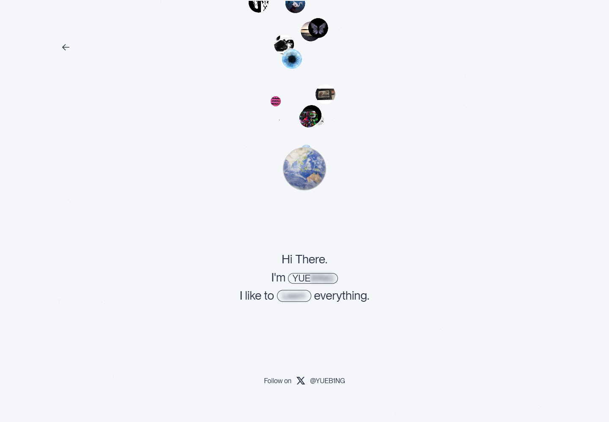
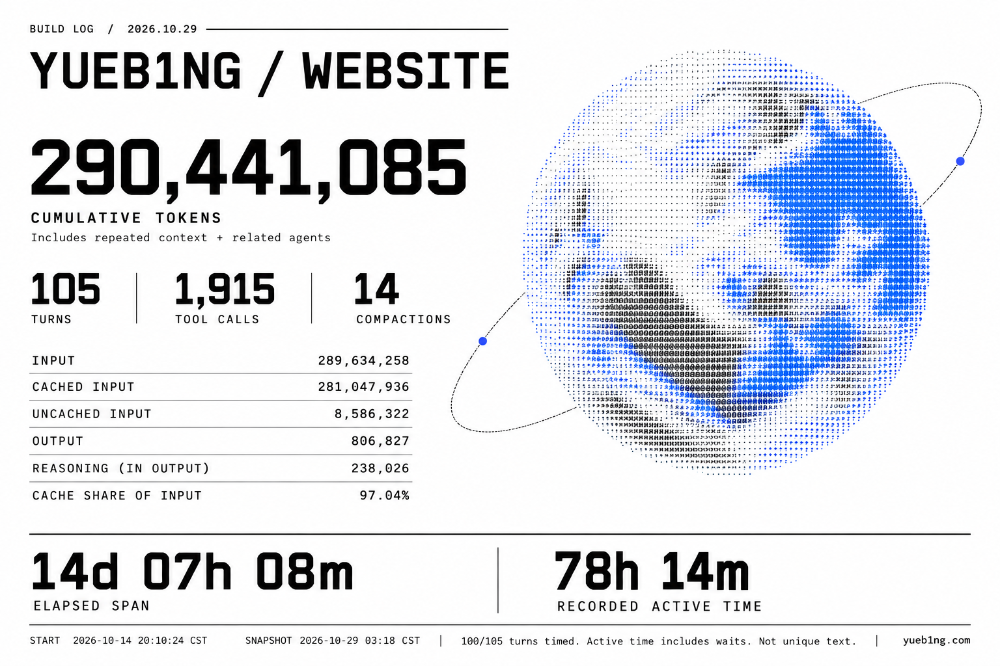
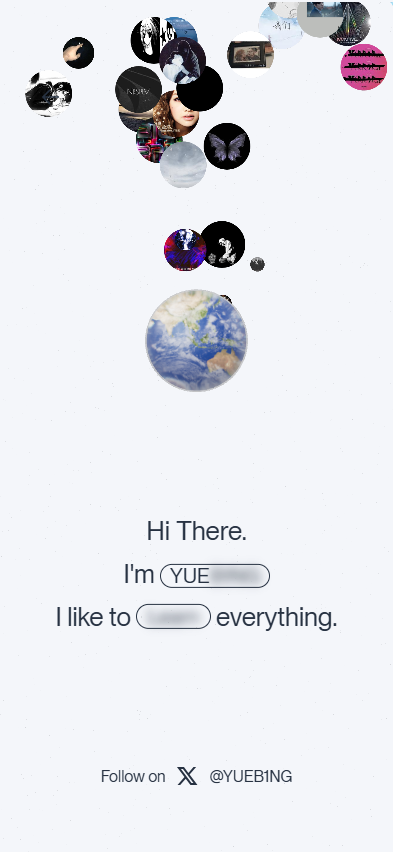

<p align="center"></p>

<p align="center"><b>简体中文</b> · <a href="README.en.md">English</a></p>

# website · YUEB1NG

**把星球 音乐和足球放进同一个交互场景**

一个基于 TypeScript、Three.js 和 Cloudflare Worker 的个人主页：从蓝图开屏进入玻璃星球，在同一场景里探索音乐封面轨道、足球粒子重组、文字揭示与日夜主题。

[在线体验](https://yueb1ng.com/) · [交互细节](docs/INTERACTIONS.zh-CN.md) · [后端与部署](docs/DEPLOY.md) · [贡献说明](CONTRIBUTING.md) · [素材来源](SOURCES.md)

封面是 AI 概念插图；下面是实际公网页面截图。插图不代表额外功能、精确模型或截图。



## 开发过程公开记录

本项目保留脱敏的开发统计：累计 token、对话轮数、工具调用、耗时及统计局限。数据为历史快照，不代表实际账单。

[](docs/development/README.md)

[完整统计与口径 / Full record](docs/development/README.md) · [JSON](docs/development/conversation-stats-20261029.json) · [记录模板 / Template](docs/development/TEMPLATE.md)

## 快速开始

使用 Node.js 24 或更新的受支持版本，在项目目录运行：

```sh
git clone https://github.com/YUEB1NG/website.git
cd website
npm ci
npm run dev
```

打开终端显示的地址，默认 `http://127.0.0.1:5173`。首次加载需要准备字体和图形资源；浏览器需要支持 WebGL，减少动态效果模式提供简化交互。

```sh
npm run build
npm run preview
```

前端产物在 `dist/client/`，后端 Worker 在 `dist/server/`。生产预览与开发服务器均可独立运行。Windows 可在构建后运行 `python -X utf8 run-local.py` 启动独立预览，再用 `python -X utf8 run-local.py --stop` 停止同一项目进程。

## 怎么玩

| 操作 | 结果 |
| --- | --- |
| 上拖透明圈、点击 Start，或按 Enter / ↑ | 进入场景 |
| 点击星体 | 返回透明圈，再次进入时探索下一个星体 |
| 长按 550 ms 或按 O | 将同一组封面移入或释放椭圆轨道 |
| 点击 like | 通过粒子重组切换历届世界杯风格足球 |
| 点击姓名与 Learn | 揭示文字或切换 Learn / Build / Share |
| 点击头像 | 切换并保存手动日夜主题 |
| 点击漂浮封面或 Celebrate | 弹出贴纸 |
| Escape 或返回按钮 | 退出或返回 |

每次访问随机显示 20–25 个音乐封面，选择时排除同屏、待显示与近期使用的相同封面。球体、轨道、文字和粒子均遵循系统减少动态效果设置。更多行为与历史调整见 [交互记录](docs/INTERACTIONS.zh-CN.md)。

<details>
<summary>实际手机视口截图</summary>



这是 Chromium 手机视口检查，不等于 iPhone Safari 或 Android 真机验收。

</details>

## 歌单与后端

| 接口 | 用途 |
| --- | --- |
| `GET /api/playlist` | 读取 R2 中保存的完整快照，首次使用内置种子 |
| `GET /api/covers/{songId}` | 从白名单来源读取并缓存已知歌曲的封面 |
| `POST /api/playlist/refresh` | 验证服务端密钥后更新完整歌单，不接受不完整结果覆盖 |

独立托管需要配置 Cloudflare R2 的 `BUCKET` 绑定，以及平台密钥 `PLAYLIST_UPDATER_TOKEN`。密钥不进入源码、前端或 URL。静态服务可以展示前端及本地封面回退，完整歌单 API 需要 Worker。[部署说明](docs/DEPLOY.md) · [刷新行为](docs/playlist-refresh.md)

每日刷新还需要独立调度器调用受保护接口；仓库包含刷新实现，不表示任意新部署已自动启用调度。上游接口与封面资源可能变化，失败时保留最后成功快照。

## 开发检查

```sh
npm run build
node --test tests/playlist.test.mjs tests/football-handoff.test.mjs tests/cover-picker.test.mjs tests/entrance.test.mjs
```

2026-10-26：构建及上述 11 项单元测试通过；公网 1440 px 与 393 px 视口进入场景、截图及布局检查通过，未观察到页面脚本错误。减少动态效果、连点、轨道和全部历史交互的专门检查见 tests；本次仓库整理没有改动这些实现。

## 来源与边界

项目参考 Wabi、imdaryl、ped.ro、React Bits 和 Three.js，保留 [SOURCES.md](SOURCES.md) 与已有许可。星球贴图、字体、音乐封面、照片与第三方素材各自保留权利，公开仓库不将它们统一改为 MIT。[素材与许可说明](docs/ASSET-NOTICES.md)

公网网站由托管平台运行，不依赖本机终端或本次编辑会话持续开启。真实手机、GPU 性能与不同网络条件仍需分别验证。
